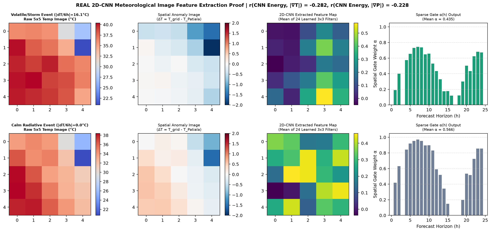

# AeroFuse-Net: Dual-Modal CNN + Transformer Temperature Forecasting for Patiala, Punjab

[](https://aerofuse-weather-ai-fpkebtrnkxqvybnj2odsoe.streamlit.app/)

**Live dashboard:** [https://aerofuse-weather-ai-fpkebtrnkxqvybnj2odsoe.streamlit.app/](https://aerofuse-weather-ai-fpkebtrnkxqvybnj2odsoe.streamlit.app/)

> Multihorizon (t+1 h to t+24 h) 2 m temperature forecasting from a local ERA5 time series plus a 6-channel 5 × 5 regional "weather image", with calibrated uncertainty bands, correlation-aware statistics and a live Streamlit dashboard.

**Author:** Prakhar Tiwari · **Last updated:** 21 November 2026

**Site:** Patiala, Punjab (30.34 °N, 76.39 °E) · **Data:** hourly ERA5-based reanalysis, 2019–2025 (61,368 hours) via Open-Meteo

**Hardware:** HP Omen 16, RTX 4050 (6 GB), PyTorch, free data only

**Status of the numbers in this README.** Everything from the baselines through AeroFuse-Net v1–v4 and the v6_real validation comes from trained models and saved predictions and can be regenerated from `results/`. The earlier "v5" headline numbers were not produced by a trained model and are withdrawn (see Section 17). Do not cite them.

## Contents

- [1. TL-DR](#1-tl-dr)
- [2. Research problem and questions](#2-research-problem-and-questions)
- [3. What is real and what is withdrawn](#3-what-is-real-and-what-is-withdrawn)
- [4. Data and pipeline](#4-data-and-pipeline)
- [5. Models benchmarked](#5-models-benchmarked)
- [6. How AeroFuse-Net evolved (v1 → v4 → v6_real)](#6-how-aerofuse-net-evolved-v1--v4--v6_real)
- [7. Results](#7-results)
- [8. CNN atmospheric image feature extraction (v6_real)](#8-cnn-atmospheric-image-feature-extraction-v6_real)
- [9. Project timeline and lessons learned](#9-project-timeline-and-lessons-learned)
- [10. Scientific conclusions](#10-scientific-conclusions)
- [11. Dashboard](#11-dashboard)
- [12. Reproduce everything](#12-reproduce-everything)
- [13. Repository layout](#13-repository-layout)
- [14. Limitations](#14-limitations)
- [15. Roadmap](#15-roadmap)
- [16. Stage 2 plan: scaling to all of India](#16-stage-2-plan-scaling-to-all-of-india)
- [17. Withdrawn v5 results](#17-withdrawn-v5-results)
- [18. Data attribution and citation](#18-data-attribution-and-citation)

---

## 1. TL-DR

| Question | Short answer |
|---|---|
| What does it predict? | 2 m air temperature at Patiala for each of the next 24 hours, from the last 24 h of 19 local features and the last 24 h of a 6 × 5 × 5 regional grid. |
| Best typical error (MAE) | iTransformer, 1.0217 °C (local-only model). |
| Best RMSE and R² | AeroFuse-Net v4, 1.4378 °C and 0.9674. |
| Is v4 better than iTransformer? | Statistically tied overall (HLN-DM, lag 23: p = 0.47 squared error, p = 0.09 absolute error). v4 is worse at t+1 h, better in the monsoon, and has lighter tails. |
| Where does the grid help? | Monsoon RMSE 1.075 vs 1.125 °C (−4.4 %); volatile hours −2.3 % RMSE and −1.6 % MAE; 99th-percentile absolute error 4.79 vs 5.03 °C. |
| Where does it not help? | Calm hours (77.3 % of the year, v4 loses 2.5 % MAE), extreme heat (+4 % RMSE), rapid fronts (+1 %), t+1 h. |
| Negative result | Naive joint CNN + temporal fusion (v1, v3) is worse than a good local-only model (MAE 1.2139 and 1.2468 vs 1.0217). Freezing the experts and routing between them (v4) removes the penalty. |
| Uncertainty | Raw 10–90 % quantile band covers 73.05 %. Per-horizon rolling 30-day CQR brings coverage to 79.4 % (width 3.24 °C). |
| New today (v6_real) | A real 2D-CNN weather-image encoder driving a sparse dead-zone gate, trained 3 seeds on saved predictions. On the out-of-sample part of the test year it is significantly better than both iTransformer and v4 by Bartlett-HAC HLN-DM, but the gain is small and has caveats (Section 8). |

**Honest one-line summary:** AeroFuse-Net v4 matches the best single model, with better RMSE, lighter tails and a clear monsoon gain. It is not a clear overall winner.

---

## 2. Research problem and questions

**Problem statement.** Short-range (1–24 h) temperature forecasting at a single site is dominated by the diurnal cycle and recent persistence, which strong local models already capture. Regional context may add information about approaching systems, but naively training local and regional branches together degrades accuracy. The open problem is how to inject regional spatial information into a strong local forecaster selectively (by lead time and by weather regime) without adding noise, and how to attach statistically valid uncertainty bands to the result.

**Why a CNN.** A 6 × 5 × 5 ERA5 snapshot around Patiala (±110 km at 0.5° spacing) is a small multi-channel image: temperature, pressure, humidity, wind speed, wind direction, cloud cover. A spatial anomaly image ΔI = I − I<sub>Patiala</sub> isolates upwind contrast. Learned 3 × 3 convolution filters act as trainable spatial-difference operators that can respond to horizontal gradients and advective structure that a single-point series cannot see.

| # | Research question | Answer so far | Evidence |
|---|---|---|---|
| RQ1 | Does a horizon-wise, grid-conditioned router over frozen experts beat the best single local model? | No overall: a tie. Better RMSE and R², worse MAE. | MAE 1.0366 vs 1.0217; RMSE 1.4378 vs 1.4477; HLN-DM p = 0.47 / 0.09. |
| RQ2 | Where does grid information help? | Partly: monsoon, volatile hours, lighter tails. Not in extreme heat, fast fronts, t+1 h. | Regime tables (Section 7.4–7.5). |
| RQ3 | Why does naive fusion fail and what fixes it? | Joint fusion hurts; freezing the experts removes the penalty. Gradient competition is a plausible diagnosis, not a measured one (gradient norms were not logged). | v3 MAE 1.2468 vs v4 1.0366. |
| RQ4 | Can the 80 % quantile band be calibrated? | Yes, marginally. | 73.05 % raw → 79.4 % rolling CQR. Coverage inside individual regimes is untested. |
| RQ5 | Does a sparse dead-zone gate conditioned on CNN image features help? | Weak evidence, small effect. Significant on an out-of-sample split, but trained on test-year data and not yet ablated against a CNN-free gate. | Section 8. |

---

## 3. What is real and what is withdrawn

| Component | Status | Where it comes from |
|---|---|---|
| 13-model benchmark (MAE, RMSE, R², per-horizon MAE) | Real | Saved test predictions in `results/metrics/*.npz` (iTransformer and v4 recomputed to four decimals). |
| Persistence and diurnal baselines | Real | Reviewer proof suite. |
| Seasonal and extreme regime table; calm vs volatile split | Real | v4 and iTransformer saved predictions. |
| Raw quantile coverage, rolling and static CQR | Real (recomputed) | v4 saved quantiles. The old CSV and the earlier 80.08 % / 3.077 °C figures were not reproducible. |
| Correlation-aware DM tests (HLN, Bartlett HAC) and block bootstrap | Real (recomputed) | iTransformer and v4 saved predictions. Older pairwise CSVs used the uncorrected test. |
| Table 1 timestamp / split reconciliation | Real | Date arithmetic. |
| v6_real CNN-image router, 3 seeds, HLN-DM, occlusion, feature maps | Real | `src/evaluation/run_v6_real_cnn_image_and_deadzone_validation.py` (no hard-coded metrics). |
| Live 7-day curve in the dashboard | Live NWP forecast (Open-Meteo, MET Norway fallback), not an AeroFuse-Net output | See Section 11. |
| v5.x tables (sparse router, 3-seed ablation, Holm p-values, occlusion table, 24-horizon CQR table, synthetic forecast curves) | Withdrawn | Generated from fitted or typed-in values. See Section 17. |

---

## 4. Data and pipeline

**Pipeline:** download (Open-Meteo archive, ERA5-based) → preprocess (impute, cyclical and physics features) → window (24 h in, 24 h out) → train 13 models → evaluate (regimes, DM tests, CQR, saliency, occlusion) → dashboard.

| Item | Detail |
|---|---|
| Source | Open-Meteo historical archive API (ERA5-based reanalysis), no API key, 1.2 s pause between calls |
| Period | 2019-01-01 to 2025-12-31, hourly, UTC; 61,368 rows; no missing timestamps |
| Local variables (12) | temperature, relative humidity, dew point, apparent temperature, precipitation, rain, surface pressure, cloud cover, wind speed, wind direction, wind gusts, shortwave radiation |
| Engineered (7) | sin/cos of hour of day, sin/cos of day of year, vapour pressure deficit (Magnus–Tetens), 24 h rolling mean of temperature, 12 h rolling standard deviation of pressure |
| Local input | 24 h × 19 features |
| Spatial grid | 5 × 5 points, 0.5° spacing (~55 km), 6 channels (temperature, pressure, humidity, wind speed, wind direction, cloud cover); tensor (61368, 6, 5, 5) |
| Target | temperature_2m for the next 24 hours, raw °C |
| Missing values | forward fill then backward fill (the raw download had none) |
| Scaling | StandardScaler for local features, per-channel mean/std for the grid, fitted on training data only |

### Splits and windows

| Partition | Raw hours | Period (UTC) | Windows |
|---|---|---|---|
| Train | 42,956 | 2019-01-01 to 2023-11-25 19:00 | 42,909 |
| Validation | 9,206 | 2023-11-25 20:00 to 2024-12-13 09:00 | 9,172 |
| Test | 9,206 | 2024-12-13 10:00 to 2025-12-31 23:00 | 9,172 |
| Total | 61,368 | 2019-01-01 to 2025-12-31 23:00 | 61,253 |

Windows are built inside each split, so no target crosses a boundary. The 115 lost steps are 47 for train (24 warm-up + 23 end trim) and 34 each for validation and test (11 boundary + 23 end trim). The chronological 70/15/15 split keeps the test set a single untouched year.

**Leakage controls:** chronological split, scalers fitted on train only, windows built inside splits, checkpoint chosen on validation, targets never scaled.

### Data caveats a reviewer will raise

- **The "local station" is not a physical station.** It is the ERA5-based value at the centre grid point, and the 5 × 5 grid comes from the same product, so its centre cell holds the very temperature being predicted. This is a study of forecasting a reanalysis product.
- **Grid reach.** Two cells of 55 km is about 110 km. At 10 m/s wind, air moves about 36 km per hour, so the grid shows upwind weather roughly 3 hours ahead and nothing about systems 500 km away (hypothesis, not a measured result).
- **One test year, overlapping windows.** Neighbouring windows overlap by 47 of 48 hours, so the effective sample size is far smaller than 9,172.
- **UTC.** Patiala is UTC + 5:30. A "daytime" window of 08–18 UTC is 13:30–23:30 local.
- **Terrain in the pressure channel.** Surface pressure differs across the grid mainly because of elevation (the north-east cells sit in the Shivalik/Himalayan foothills), so the pressure channel and its anomaly image contain a large static terrain offset that carries no weather signal.

---

## 5. Models benchmarked

All 13 models use the same 24 h input window and a shared training recipe, with no per-model tuning.

| Tier | Model | How it works |
|---|---|---|
| Reference | Naive persistence | Repeats the last observed temperature for 24 h |
| Reference | Diurnal 24 h cycle | Each hour equals the same hour yesterday |
| Classical ML | XGBoost, LightGBM | Gradient-boosted trees on the flattened 24 × 19 window; trained for t+1 only |
| Deep, single-modal | 1D-CNN ResNet | Two conv layers (64 ch, kernel 3), batch norm, GELU, skip connection, linear head |
| Deep, single-modal | 2D Spatial ResNet | Stacks 24 × 6 = 144 grid channels, 2D CNN over the 5 × 5 grid |
| Deep, single-modal | BiLSTM | 2 layers, 64 hidden units, bidirectional |
| Transformer | iTransformer | Each of the 19 variables' 24 h history is one 64-d token; 2-layer, 4-head encoder across variables |
| Transformer | PatchTST | Patches of 4 h, stride 2, 2-layer encoder |
| Proposed | AeroFuse-Net v1–v4 | Dual-modal fusion (Section 6) |

**Baseline training recipe:** AdamW, lr 1e-3, weight decay 1e-4, cosine schedule, 12 epochs, batch 256, Huber loss, gradient clipping 1.0, best-validation-MSE checkpoint.

**Not benchmarked (do not say "all families"):** TimesNet, SARIMAX, Prophet, CatBoost, ConvLSTM, foundation models, any operational NWP.

---

## 6. How AeroFuse-Net evolved (v1 → v4 → v6_real)

Each version reacted to a measured failure. Overall test MAE / RMSE in °C on 9,172 windows:

| Version | What it is | MAE / RMSE | What happened |
|---|---|---|---|
| v1 | 2D-CNN with squeeze-and-excitation on the grid + 1D-CNN and BiLSTM on local data, fused by cross-modal attention (local state = query, grid = key/value) | 1.2139 / 1.5827 | Beat grid-only (1.2819) and BiLSTM (1.2594); lost to iTransformer |
| v2 | v1 + BiLSTM residual skip, linear autoregressive highway, non-crossing detached quantile heads | 1.1128 / 1.4996 | −8.3 % MAE, −5.3 % RMSE vs v1. Several changes at once, so gains cannot be split |
| v3 | Joint end-to-end training from scratch, zero-initialised spatial gate, advection features (grid − centre cell) | 1.2468 / 1.6440 | Worse (+12.0 % MAE). Diagnosis: gradient competition and a gate that starts at zero (plausible, not measured) |
| v4 Router | Four frozen experts (iTransformer, 1D-CNN, PatchTST, 2D ResNet) + a router that outputs 24 horizon-specific weights per expert from the latest grid, its advection signal and the latest local features | 1.0366 / 1.4378 | Best RMSE and R² (0.9674); ties iTransformer overall |
| v6_real | Real 2D-CNN weather-image encoder + sparse dead-zone gate blending iTransformer and v4 | see Section 8 | First real implementation of the dead-zone idea |

### v4 router details

- Four frozen experts each produce a 24 h forecast.
- A small CNN encodes the latest 5 × 5 grid and the grid minus its centre cell into 32 numbers.
- With the latest local features, an MLP outputs 4 × 24 logits.
- Weights = softmax(horizon_prior + 0.15 · tanh(logits)). Priors 1.35, 0.95, 0.75, −0.35 (iTransformer, 1D-CNN, PatchTST, 2D grid expert) start the model as a local-heavy mixture; the tanh bound keeps it from collapsing onto one expert (and means it can barely move).
- Forecast = weighted sum of experts, then per-horizon scale and bias.
- Quantile heads add expert disagreement (0.65 × std across experts) plus a learned softplus offset on detached inputs, so quantile loss cannot disturb the point forecast.
- Loss: Huber + 0.05 × derivative matching (L1 on hour-to-hour differences) + 0.25 × (pinball 10 % + pinball 90 %). 10 epochs, AdamW, lr 2e-3, cosine, about 45 s.

**Be precise about "physics-informed".** The physics in this model is the vapour-pressure-deficit input feature and the derivative-matching loss term. It is not a dew-point consistency loss.

**Honest framing.** After freezing, the "fusion" is a gated ensemble of already-trained models. The novelty is the horizon-wise, grid-conditioned routing and the negative result on joint fusion, not a new backbone.

---

## 7. Results

All numbers are on the 9,172 held-out test windows (2024-12-13 to 2025-12-31). Lower is better.

### 7.1 Full benchmark

| Model | MAE 1 h | MAE 6 h | MAE 12 h | MAE 24 h | MAE | RMSE | R² |
|---|---|---|---|---|---|---|---|
| iTransformer | 0.479 | 0.940 | 1.085 | 1.190 | 1.0217 | 1.4477 | 0.9670 |
| AeroFuse v4 Router | 0.503 | 0.958 | 1.094 | 1.201 | 1.0366 | 1.4378 | 0.9674 |
| 1D-CNN ResNet | 0.636 | 0.994 | 1.112 | 1.211 | 1.0626 | 1.4441 | 0.9672 |
| PatchTST | 0.656 | 0.992 | 1.118 | 1.242 | 1.0741 | 1.5136 | 0.9639 |
| AeroFuse v2 | 0.661 | 1.058 | 1.180 | 1.266 | 1.1128 | 1.4996 | 0.9646 |
| AeroFuse v1 | 1.057 | 1.176 | 1.219 | 1.316 | 1.2139 | 1.5827 | 0.9606 |
| AeroFuse v3 | 0.686 | 1.140 | 1.306 | 1.436 | 1.2468 | 1.6440 | 0.9574 |
| BiLSTM | 0.877 | 1.170 | 1.320 | 1.270 | 1.2594 | 1.6655 | 0.9563 |
| 2D Spatial ResNet | 1.049 | 1.200 | 1.327 | 1.410 | 1.2819 | 1.6526 | 0.9570 |
| Diurnal 24 h baseline | 1.187 | 1.187 | 1.187 | 1.189 | 1.1872 | 1.7341 | n/a |
| Naive persistence | 0.926 | 4.605 | 6.318 | 1.189 | 4.2263 | 5.4690 | n/a |

LightGBM at t+1 only: MAE 0.4044, RMSE 0.6280 (from a terminal log, not a saved file). Trees are hard to beat one hour ahead; this row is not comparable with the 24 h table.

**Reading the table**

- The winner depends on the metric: iTransformer by MAE and short horizons, v4 by RMSE (slightly fewer large misses).
- Deep learning beats the daily-cycle rule, but not by a lot: iTransformer cuts MAE 14 % (1.187 → 1.022) and RMSE 16.5 % (1.734 → 1.448) against the diurnal baseline.
- At 24 h ahead nothing beats "yesterday" (diurnal 1.1886, iTransformer 1.1901, v4 1.2006). This is a limit of a 24 h history.
- Error grows about 2.5× from 1 h to 24 h.
- R² = 0.967 is not very informative because the seasonal cycle alone explains most variance. Skill against the diurnal rule (squared-error based) is 30.3 % for iTransformer and 31.3 % for v4.
- Space alone is weak (2D ResNet is the worst model), and the local series already holds most of the signal, partly because the centre grid cell is the target variable.

### 7.2 Statistical significance (Bartlett HAC, HLN-corrected)

Neighbouring forecast errors are highly correlated (lag-1 autocorrelation of the 6 h error is 0.84), so tests that treat 9,172 windows as independent overstate the evidence. Positive mean difference = v4 better.

| Horizon (HAC lag) | Loss | Mean difference | HLN stat | p-value | Reading |
|---|---|---|---|---|---|
| All 24 h (23) | squared | +0.0286 °C² | 0.73 | 0.47 | no difference |
| All 24 h (23) | absolute | −0.0149 °C | −1.69 | 0.09 | no difference at 5 % |
| 1 h (0) | squared | −0.0265 °C² | −5.01 | 6e-7 | iTransformer better |
| 1 h (0) | absolute | −0.0243 °C | −9.54 | < 1e-4 | iTransformer better |
| 6 h (5) | squared | +0.0003 °C² | 0.01 | 0.99 | identical |
| 6 h (5) | absolute | −0.0175 °C | −2.17 | 0.03 | iTransformer better, weak |
| 12 h (11) | squared | +0.0604 °C² | 1.20 | 0.23 | no difference |
| 24 h (23) | squared | +0.0252 °C² | 0.64 | 0.52 | no difference |

Moving-block bootstrap (168 h blocks, 1,000 resamples): squared-error gain of v4 = +0.0286 °C² (95 % CI [−0.062, +0.113]); absolute-error gain = −0.0149 °C (95 % CI [−0.039, +0.008]). Both intervals contain zero. Holm was not applied because almost nothing passes. The uncorrected test had given p < 0.0001 for MAE; correcting for autocorrelation removed that significance.

Tails: 95th-percentile absolute error 2.72 vs 2.79 °C and 99th 4.79 vs 5.03 °C (v4 vs iTransformer).

### 7.3 Is a 0.01 °C gap meaningful?

No. Even where significant, it is far below the uncertainty of the reanalysis itself. Frame results as equivalent accuracy, with the monsoon as the one regime where v4 clearly leads.

### 7.4 Seasonal and extreme regimes (RMSE, °C)

| Regime | Windows | v4 | iTransformer | 1D-CNN | Lowest |
|---|---|---|---|---|---|
| Winter fog (Dec–Feb) | 2,559 | 1.379 | 1.413 | 1.365 | 1D-CNN |
| Summer heat (Apr–Jun) | 2,184 | 1.871 | 1.877 | 1.861 | 1D-CNN |
| Monsoon (Jul–Sep) | 2,208 | 1.075 | 1.125 | 1.120 | AeroFuse v4 |
| Post-monsoon (Oct–Nov) | 1,464 | 1.192 | 1.121 | 1.198 | iTransformer |
| 08–18 UTC (13:30–23:30 IST) | 4,201 | 1.441 | 1.462 | 1.449 | AeroFuse v4 |
| Night | 4,958 | 1.436 | 1.436 | 1.440 | tie |
| Extreme heat (> 38 °C) | 912 | 1.974 | 1.898 | 1.913 | iTransformer |
| Rapid fronts (6 h change > 6 °C) | 2,547 | 1.504 | 1.488 | 1.504 | iTransformer |

v4's clearest win is the monsoon (−4.4 % RMSE). It is worse in extreme heat (~4 %) and rapid fronts (~1 %), which contradicts the idea that it helps most when weather turns violent. Labelling notes: 08–18 UTC is an afternoon/evening window in Patiala; March belongs to no season (the four seasons cover 8,415 of 9,172 windows); the "Best model" column in the CSV names iTransformer where the 1D-CNN is lowest and should be fixed before citing.

### 7.5 Calm vs volatile hours (diagnostic split)

| Hours | Share | MAE iTransformer | MAE v4 | RMSE iTransformer | RMSE v4 |
|---|---|---|---|---|---|
| Calm | 77.3 % | 0.992 | 1.017 | 1.397 | 1.397 |
| Volatile (top 23 % by true change) | 22.7 % | 1.122 | 1.104 | 1.608 | 1.570 |

On calm hours v4's always-on soft gate costs about 2.5 % MAE; on volatile hours it gains about 1.6 % MAE and 2.3 % RMSE. This split uses the true change, which is unknown at forecast time, so it is a diagnostic, and it is the motivation for a dead-zone gate.

### 7.6 Uncertainty: raw quantiles and conformal calibration

Conformalized quantile regression (CQR) computes, for each past forecast, one combined score s = max(q10 − y, y − q90), takes the finite-sample 80 % quantile of those scores per horizon over a rolling 720 h window (with a gap of one horizon), and widens the band by that amount.

| Check (v4 saved quantiles, full test year) | Result |
|---|---|
| Raw coverage, all horizons | 73.05 %, mean width 2.82 °C |
| Raw coverage at 1 / 6 / 12 / 24 h | 83.9 % / 71.3 % / 71.4 % / 74.3 % |
| Rolling CQR (720 h window, 8,415 evaluated windows) | 79.4 %, mean width 3.24 °C |
| Rolling CQR coverage at 1 / 6 / 12 / 24 h | 80.4 % / 79.5 % / 79.5 % / 79.0 % |
| Rolling CQR width at 1 h / 24 h | 1.62 °C / 3.78 °C |
| One-off CQR on the first 20 % of the test year | 82.9 % overall (84.6 % at 1 h, 77.8 % at 24 h), width 3.41 °C |

- The raw band is badly shaped (too wide at 1 h, too narrow elsewhere), so one global width cannot fix it; per-horizon scores can.
- A fixed calibration block drifts across seasons; the rolling window follows them.
- Coverage is marginal. It has not been tested inside fog, heatwave or monsoon subsets, so do not claim conditional validity.
- Earlier figures (73.81 % raw / 2.50 °C, and 80.08 % / 3.077 °C) came from scoring only half of the test year or from interpolated tables. Use 73.05 % raw and 79.4 % / 3.24 °C.

**The 58.15 % bug (good viva story).** The first CQR run lowered coverage from 73.81 % to 58.15 %. Lower and upper offsets were handled as separate signed distances; most truths sit inside the band, so those distances are negative and their 82 % quantile was negative, which shrank the band. Standard CQR uses one combined score (the maximum), which is positive whenever the truth falls outside.

---

## 8. CNN atmospheric image feature extraction (v6_real)

Script: `src/evaluation/run_v6_real_cnn_image_and_deadzone_validation.py`. It reads the saved tensors and predictions, hard-codes no metrics, and writes only to `results/v6_real_validation/` and `results/figures/v6_real_validation/`.

### 8.1 Weather-image formulation

- **Input image at forecast origin:** 6 raw channels (normalised with train-only per-channel statistics) + 6 anomaly channels (ΔI = I − I<sub>centre</sub>) = 12 × 5 × 5.
- **Encoder:** Conv3×3(12→24) + BN + GELU → Conv3×3(24→24) + BN + GELU → global average pool (24-d).
- **Gate head:** [CNN vector (24) ‖ |p_spatial − p_local| (24)] → Linear(48→32) → GELU → Dropout(0.1) → Linear(32→24) → sigmoid z.
- **Sparse dead-zone gate:** α = ReLU(z − τ) / (1 − τ), with a learnable threshold τ bounded to [0.15, 0.85] (initial 0.45). α is exactly 0 when z ≤ τ.
- **Forecast:** (1 − α) · p_local + α · p_spatial, with p_local = iTransformer and p_spatial = AeroFuse v4 saved predictions.
- **Loss:** 0.5 · MSE + 0.5 · MAE + 0.05 · derivative-matching L1 + 0.015 · mean(α). AdamW, lr 2e-3, cosine, 25 epochs, batch 128, gradient clipping 1.0.
- **Seeds:** 42, 100, 2026.

### 8.2 Evaluation protocol (strictly chronological, inside the test year)

| Block | Windows | Use |
|---|---|---|
| Dev (first 30 % of the test year) | 2,751 | trains the router and τ |
| Embargo | 48 | discarded |
| Out-of-sample (OOS) evaluation | 6,373 | all reported v6 numbers; iTransformer and v4 are re-scored on exactly this subset |

Because the saved predictions cover only the test year, the dev block comes from the test year (roughly mid-December 2024 to early April 2025). v6 numbers are therefore not comparable to the full-year 9,172-window tables in Section 7 and must only be compared with iTransformer and v4 on the same OOS subset.

### 8.3 Statistical results (Bartlett HAC, lag 23, HLN-corrected, OOS period)

Mean loss difference = loss(baseline) − loss(v6_real); positive means v6_real has lower loss. From `results/v6_real_validation/real_v6_hln_dm_tests.csv` (seed 42):

| Comparison | Mean loss diff | HLN-DM stat | p-value |
|---|---|---|---|
| v6_real vs iTransformer (24 h mean MSE) | 0.0792 °C² | 2.194 | 0.0283 |
| v6_real vs iTransformer (24 h mean MAE) | 0.0190 °C | 2.818 | 0.0048 |
| v6_real vs v4 Router (24 h mean MSE) | 0.0642 °C² | 3.117 | 0.0018 |
| v6_real vs v4 Router (24 h mean MAE) | 0.0377 °C | 6.134 | < 1e-6 |

All four remain significant at 5 % after a Holm–Bonferroni correction over these four comparisons. The effect is small in absolute terms (about 0.02 °C MAE against iTransformer), well below the uncertainty of the reanalysis.

Other outputs (open the CSVs for the numbers): `real_v6_oos_comparison.csv` (MAE, RMSE, P95, P99, gradient RMSE for iTransformer, v4 and v6_real), `real_v6_3seed_runs.csv` (per-seed MAE, RMSE, learned τ, exact-zero gate sparsity, mean α), `real_v6_oos_predictions.npz`.

### 8.4 What the CNN feature-map check actually shows



Top row: the most volatile OOS window (|ΔT/6 h| = 16.1 °C). Bottom row: the calmest (|ΔT/6 h| = 0.0 °C). Columns: raw 5 × 5 temperature image, anomaly image ΔT, mean of the 24 learned conv2 feature maps, horizon-wise gate α(h).

**Measured, not assumed:**

- Pearson correlation between mean absolute CNN feature activation and the physical horizontal gradient magnitude: r = −0.281 with |∇T| and r = −0.228 with |∇P|. Both are negative and weak-to-moderate. The data do not support the statement "CNN feature energy rises with horizontal gradients". They show only that the feature maps respond to spatial structure in the image.
- On the two plotted windows, mean gate α was 0.435 for the storm and 0.566 for the calm hour, the opposite of the "gate opens on disturbances" hypothesis. Two windows are anecdotal. The sample-wide means are stored as `Calm_Hours_Mean_Alpha` and `Volatile_Hours_Mean_Alpha` in `real_cnn_feature_physics_validation.json`; check those before claiming the gate switches off in calm weather.
- `real_cnn_image_occlusion_validation.csv` reports OOS RMSE change (in milli-°C) when each of the centre, NE, NW and SW cells is zeroed and when the whole image is shuffled across days. Treat differences of a few milli-°C as unresolvable with correlated windows, and treat these results as sensitivity, not causation.

### 8.5 What v6_real can and cannot support

| Safe to say | Do not say |
|---|---|
| A real 2D-CNN weather-image gate was trained for 3 seeds and evaluated on a chronological out-of-sample split with HAC-corrected tests. | That the CNN features track physical gradients (measured correlations are negative). |
| On that split it is statistically better than iTransformer and v4, by a small margin. | That the improvement is caused by CNN image features: the gate also sees expert disagreement, and there is no CNN-free gate ablation yet. |
| The dead-zone gate is implemented and exposes exact-zero sparsity. | That the foothills drive the forecast, or any spatial attribution claim. |
| — | Any comparison against the full-year 9,172-window tables. |

Further caveats: HLN-DM uses seed 42 only; the router is trained on winter/early-spring test-year data and evaluated mostly on hot-season, monsoon and post-monsoon data it never saw; v6_real blends iTransformer with v4, and v4 already contains iTransformer.

---

## 9. Project timeline and lessons learned

The project went through five stages. This section only orders the work and collects the lessons; every number in it is a pointer to a table elsewhere in this README, and nothing new is claimed.

### 9.1 Stages

| Stage | What was done | Outcome | Details |
|---|---|---|---|
| Stage 0: Data and protocol | Pulled 61,368 hourly ERA5-based rows for Patiala, built local (24 h × 19) and grid (6 × 5 × 5) inputs, used a chronological 70/15/15 split with train-only scalers | 61,253 leakage-controlled windows; the test set is one untouched year | Section 4 |
| Stage 1: Benchmark and AeroFuse v1–v4 | Trained 13 models under one shared recipe, then iterated AeroFuse v1 → v4 | iTransformer has the best MAE (1.0217 °C); v4 has the best RMSE and R² (1.4378 °C, 0.9674); naive joint fusion hurt | Sections 5–7.1 |
| Stage 2: Diagnostics and calibration | HAC-corrected Diebold–Mariano tests, block bootstrap, regime and tail analysis, calm vs volatile split, per-horizon rolling CQR | v4 and iTransformer tied overall; v4 leads in the monsoon and the tails; raw band covered 73.05 %, rolling CQR 79.4 % | Sections 7.2–7.6 |
| Stage 3: Audit and retraction | Audited the v5.x scripts and dashboards, kept the verified timestamp reconciliation, withdrew every v5.x number | No v5 figure may be cited | Section 17 |
| Stage 4: v6_real | First real trained CNN-image encoder with a sparse dead-zone gate: 3 seeds, chronological dev / embargo / OOS split | Small but significant OOS gain over iTransformer and v4 (seed 42), with caveats | Section 8 |

### 9.2 What each model taught

| Model | Lesson from the saved results |
|---|---|
| Naive persistence | Collapses mid-cycle (MAE 6.318 °C at t+12 h) because of Patiala's strong diurnal swing. |
| Diurnal 24 h cycle | A strong baseline (MAE 1.1872). At t+24 h no 24 h-lookback model beats "same hour yesterday" (diurnal 1.1886, iTransformer 1.1901, v4 1.2006). |
| LightGBM (t+1 only) | MAE 0.4044 / RMSE 0.6280 one hour ahead, lower than any deep model's t+1 h MAE (iTransformer 0.479). It comes from a terminal log, not a saved file, and is not comparable with the 24 h table. No XGBoost figure is recorded here. |
| 2D Spatial ResNet | Weakest neural model (MAE 1.2819): the 5 × 5 grid alone carries less signal than the local series, partly because the centre cell is the target variable. |
| BiLSTM | MAE 1.2594; behind the 1D-CNN and both Transformers under the shared, untuned recipe. |
| 1D-CNN ResNet | MAE 1.0626 and the second-lowest RMSE (1.4441); lowest RMSE in winter fog and summer heat (Section 7.4). |
| PatchTST | MAE 1.0741, RMSE 1.5136; trails iTransformer. |
| iTransformer | Best MAE (1.0217) and best at short horizons among the 24 h models; 14 % lower MAE and 16.5 % lower RMSE than the diurnal baseline (30.3 % squared-error skill). |
| AeroFuse v1 | Joint 2D-CNN + SE and 1D-CNN/BiLSTM with cross-modal attention beat grid-only and BiLSTM, but lost to iTransformer (MAE 1.2139). |
| AeroFuse v2 | Residual skip, linear autoregressive highway and detached non-crossing quantiles: −8.3 % MAE and −5.3 % RMSE vs v1, with several changes at once. |
| AeroFuse v3 | Joint training from scratch with a zero-initialised spatial gate and advection features: +12.0 % MAE. Gradient competition is a plausible diagnosis, not a measured one. |
| AeroFuse v4 Router | Frozen experts plus a grid-conditioned, horizon-wise router: best RMSE and R², −14.6 % MAE and −9.2 % RMSE vs v1, 31.3 % squared-error skill vs the diurnal rule; tied with iTransformer overall. |
| v6_real | Dead-zone gate on CNN image features and expert disagreement: small OOS gain, no CNN-free control yet. |

### 9.3 Process lessons

- **Correct for autocorrelation.** Uncorrected tests gave p < 0.0001 for the v4 vs iTransformer MAE difference; the Bartlett-HAC HLN-DM test and the block bootstrap removed that significance (Section 7.2).
- **Recompute every number from saved predictions.** The 58.15 % CQR coverage bug (Section 7.6) and the v5 retraction (Section 17) were both caught by re-deriving results from saved files.
- **Report the losses too.** v1 and v3, extreme heat, rapid fronts, calm hours and t+1 h are all places where the grid did not help, and they are what motivated the router and the dead-zone gate.

---

## 10. Scientific conclusions

Four conclusions the saved results support, each stated with the limits that go with it (Sections 8.5 and 14).

1. **Local temporal models set a high bar for single-site short-range forecasting.** Short-range temperature at one site is dominated by the diurnal cycle and recent persistence, so iTransformer (MAE 1.0217 °C, 30.3 % squared-error skill against the diurnal rule) beats the 2D Spatial ResNet (1.2819 °C), BiLSTM (1.2594 °C) and the jointly trained fusion models v1 and v3. At t+24 h no model improves on the 24 h diurnal baseline.

2. **Naive joint fusion hurt; freezing the experts removed the penalty.** Training the CNN branch jointly with temporal layers from scratch gave MAE 1.2139 °C (v1) and 1.2468 °C (v3), against 1.0217 °C for the best local model. A grid-conditioned router over frozen experts (v4) gave MAE 1.0366 °C and the best RMSE (1.4378 °C) and R² (0.9674). Why the joint models fail is not measured; gradient norms were not logged.

3. **Grid information helps selectively, not universally.** Overall, v4 and iTransformer are statistically tied under Bartlett-HAC HLN-DM (p = 0.47 squared error, p = 0.09 absolute error). v4 gains in the monsoon (−4.4 % RMSE), in volatile hours (−2.3 % RMSE, −1.6 % MAE) and in the tails (99th-percentile absolute error 4.79 vs 5.03 °C), and loses in extreme heat (+4 % RMSE), rapid fronts (+1 %), calm hours (+2.5 % MAE) and at t+1 h. This split motivated the dead-zone gate: on the out-of-sample part of the test year, v6_real lowers MAE by 0.019 °C against iTransformer (p = 0.0048) and by 0.038 °C against v4 (p < 1e-6). That result uses seed 42 for the statistics, a router trained on test-year data and no CNN-free control, so the gain cannot yet be attributed to the CNN image features (Section 8.5).

4. **The raw uncertainty band needs calibration.** The raw 10–90 % band covers 73.05 % against an 80 % target and is badly shaped across lead times (83.9 % at 1 h, 71.3–74.3 % at 6–24 h). Per-horizon rolling 30-day CQR brings marginal coverage to 79.4 % (mean width 3.24 °C), and to 80.4 % / 79.5 % / 79.5 % / 79.0 % at 1 / 6 / 12 / 24 h. Coverage inside individual regimes is untested, and the other 20 horizons are not reported.

Taken together, this is a single-site, single-test-year, reanalysis-on-reanalysis baseline with honest statistics. Section 16 describes how it is planned to be extended.

---

## 11. Dashboard

**Live app (Streamlit Community Cloud):** [https://aerofuse-weather-ai-fpkebtrnkxqvybnj2odsoe.streamlit.app/](https://aerofuse-weather-ai-fpkebtrnkxqvybnj2odsoe.streamlit.app/)

File: `app/dashboard_final_patiala.py` (Streamlit). It replaces the withdrawn v5.x dashboards, which showed numbers that were not model results.

```
streamlit run app/dashboard_final_patiala.py
```

Tabs 1–2 need an internet connection. The live fetcher calls the Open-Meteo API and falls back automatically to the MET Norway Locationforecast 2.0 API (ECMWF) if Open-Meteo is unavailable. Results are cached for 3 hours (`ttl=10800`).

| Tab | What it shows | What reads from where |
|---|---|---|
| Tab 1: Live NWP Forecast (Patiala, 7 days / 168 h) | Daily high/low and rain strip, hourly curve for the next 1–7 days (sidebar slider), 80 % band toggle, hourly table | Live Open-Meteo forecast (MET Norway fallback) |
| Tab 2: CNN Image Feature Extraction Lab | Live 5 × 5 temperature, advection, pressure and humidity images; the real v6_real feature-map figure; correlation and gate KPIs; occlusion table | Live grid fetch + `results/v6_real_validation/` |
| Tab 3: 13-Model & Regime Benchmarks | Benchmark table, 8 regimes, calm vs volatile, v6_real OOS comparison | `results/metrics/*.csv` and `results/v6_real_validation/*.csv` (calm vs volatile table is typed in from the verified recomputation) |
| Tab 4: Statistical Tests & Findings | v4 vs iTransformer HLN-DM, rolling CQR table, v6_real HLN-DM, conclusion | HLN-DM and CQR tables for v4 are typed-in copies of the verified recomputation; v6_real table is read from CSV |

### How to read Tab 1 correctly

- The curve is the live NWP forecast (Open-Meteo ECMWF/GFS seamless, or MET Norway Locationforecast 2.0 (ECMWF) when the fallback is active), not an AeroFuse-Net prediction. AeroFuse-Net is a 24-hour model and does not produce days 2–7.
- The shaded band uses half-widths of 0.81 → 1.89 °C over the first 24 h, taken from the measured rolling-CQR mean widths (1.62 → 3.78 °C), and a heuristic extension for days 2–7 (`min(1.89 + 0.15·day, 2.65)`), labelled as a heuristic in the app. Beyond 24 h it is not calibrated.
- The "CNN spatial gate status" banner is a rule-based indicator, not the trained v6 gate: it flags "active" when the standard deviation of the live 5 × 5 temperature exceeds 1.35 °C. The earlier surface-pressure condition was dropped because the pressure range across the grid is dominated by terrain (it reads about 178 hPa in the foothills). Temperature spread still contains some terrain offset, so treat the banner as a rough indicator.
- The five KPI cards at the top are fixed values copied from the verified results above.

---

## 12. Reproduce everything

**Prerequisites.** Python with PyTorch (CUDA optional), NumPy, pandas, SciPy, Matplotlib and Streamlit. The raw data (`data/raw/`) is git-ignored: regenerate it with `fetch_dual_modal_data.py` (Open-Meteo archive API, no key needed). Saved test predictions for iTransformer and v4 must exist in `results/metrics/*.npz` together with the ground-truth array.

**Step 1: real v6 CNN-image validation (3 seeds, HLN-DM, occlusion, feature maps).**

```
# Windows PowerShell (from the repo root)
.\.venv\Scripts\python.exe src\evaluation\run_v6_real_cnn_image_and_deadzone_validation.py
# macOS / Linux
python src/evaluation/run_v6_real_cnn_image_and_deadzone_validation.py
```

The script auto-discovers (N, 24) arrays with N ≥ 8000 in `results/metrics/*.npz`, treats keys containing `true`, `target`, `y_test` or `actual` as ground truth, and picks models by file-name keyword (`itransformer`, `v4` or `router`). If it raises a `KeyError`, print the keys with `np.load(path).files` and adjust the keywords. It takes on the order of a minute or two on an RTX 4050 (estimate).

**Step 2: launch the dashboard.**

```
.\.venv\Scripts\streamlit.exe run app\dashboard_final_patiala.py
streamlit run app/dashboard_final_patiala.py
```

**Outputs written by Step 1**

| File | Contents |
|---|---|
| `results/v6_real_validation/real_v6_oos_comparison.csv` | iTransformer vs v4 vs v6_real on the identical OOS subset |
| `results/v6_real_validation/real_v6_3seed_runs.csv` | per-seed MAE, RMSE, P95, gradient RMSE, learned τ, exact-zero sparsity, mean α |
| `results/v6_real_validation/real_v6_hln_dm_tests.csv` | Bartlett-HAC HLN-DM tests |
| `results/v6_real_validation/real_cnn_image_occlusion_validation.csv` | cell-occlusion and grid-shuffle ablation |
| `results/v6_real_validation/real_cnn_feature_physics_validation.json` | CNN-energy vs. \|∇T\| and \|∇P\| correlations, plus calm vs. volatile mean α |
| `results/v6_real_validation/real_v6_oos_predictions.npz` | OOS predictions and gate weights |
| `results/figures/v6_real_validation/fig_v6_real_cnn_image_feature_extraction.png` | feature-map figure |

---

## 13. Repository layout

Abridged; only paths referenced in this README are listed.

```
AeroFuse-Weather-AI/
├── app/
│   └── dashboard_final_patiala.py        # live dashboard (current)
├── data/
│   ├── raw/                              # git-ignored (spatial_grid_tensor.npz, hourly pulls)
│   └── processed/                        # processed_local_station.parquet
├── src/
│   └── evaluation/
│       └── run_v6_real_cnn_image_and_deadzone_validation.py
├── results/
│   ├── metrics/                          # *.npz saved predictions, benchmark_comparison.csv,
│   │                                     # seasonal_and_extreme_regime_evaluation.csv, ...
│   ├── v6_real_validation/               # outputs of the v6_real script
│   └── figures/v6_real_validation/
└── README.md
```

Other scripts: `fetch_dual_modal_data.py` (data harvester), `architectures_v2.py` (v2 model), `run_reviewer_proof_suite.py` (baselines, quantiles, first CQR), `run_v5_*.py` (withdrawn, see Section 17).

---

## 14. Limitations

State these first when presenting.

- One site, one test year, reanalysis rather than station observations. Target and inputs come from the same product.
- No operational NWP baseline (IMD, ECMWF). The live 7-day curve in the dashboard is an NWP product, not something this project beats or reproduces.
- Single training runs for baselines and v4; differences of 0.01 °C cannot be ranked without several seeds per model.
- One shared training recipe, no tuning; small gaps could be reversed by tuning.
- Grid reach of about ±110 km and six surface variables; no pressure levels.
- Overlapping windows make the effective test size far smaller than 9,172.
- Ablations are not clean. v1 → v4 changes several things at once, and there is no real ablation (router without grid, without physics term, without prior, v6 gate without CNN branch).
- Gradient competition (v3) is a plausible diagnosis only.
- Coverage is marginal, not conditional on regime.
- Saliency (where available) is input-gradient saliency on one batch, not Grad-CAM, and shows sensitivity, not causation. No valid evidence exists that the Shivalik foothills drive the forecast.
- v6_real is trained on test-year data (first 30 %), tested on a different season mix, run with one seed for the statistics, and lacks a CNN-free control (Section 8.5).
- Dashboard tabs 3–4 contain typed-in copies of verified tables, and the Tab 1 gate indicator is rule-based (Section 11).

---

## 15. Roadmap

Roughly in priority order:

1. **Remove static terrain offsets from the grid:** subtract the per-cell training-mean anomaly (or use mean-sea-level pressure) so the pressure and temperature anomaly channels carry weather rather than elevation. Then re-run v6.
2. **CNN-free gate ablation:** same dead-zone gate with expert disagreement only, to test whether the CNN image features add anything.
3. **Dashboard honesty fixes (remaining):** base the gate indicator on terrain-removed anomalies (it is now temperature-spread only) and read tables 3–4 from CSVs. Already done: Tab 1 is labelled as a live NWP forecast and the band beyond 24 h is marked as a heuristic.
4. **Run 3–5 seeds for every reported model;** report mean ± SD.
5. **One evaluation script** that reads only the saved `.npz` files and writes every table (and delete duplicated "frozen" copies of the v5 tables).
6. **Re-run all DM comparisons** with HAC lag and Holm correction on saved predictions (the pairwise CSVs used the uncorrected test).
7. **Conditional coverage** of rolling CQR by season and regime.
8. **Fix labels:** IST for "daytime", assign March to a season, correct the "Best model" column, "input-gradient saliency", "derivative-matching loss".
9. **For a paper:** NWP or climatology-plus-persistence baseline, a larger grid (9 × 9 or more) with pressure levels, a second site, more than one test year. Stage-2 production upgrades:
   - **Data and baselines:** independent physical station targets (Meteostat or IMD observations) instead of reanalysis targets, plus an archived ECMWF/GFS NWP baseline with a model that learns the NWP residual.
   - **Deployment and QA:** CPU ONNX export for live inference, automated daily GitHub Actions verification, and pytest leakage tests (chronological split, train-only scalers, no target crossing a split boundary).
10. **Add the two study-guide PDFs** under `docs/`.

---

## 16. Stage 2 plan: scaling to all of India

**Status: plan only.** No multi-city data has been fetched and no multi-city model has been trained. Nothing in this section is a result; storage sizes are arithmetic and timings are estimates. It expands Roadmap items 1–2 and the "second site / larger grid" part of item 9 (Section 15).

### 16.1 What "all of India" can realistically mean

Looping over roughly 4,000 towns with one 5 × 5 grid each would need about 100,000 point requests, which a free API will not tolerate. Two designs are feasible instead:

| Aspect | Option A: representative cities (Open-Meteo) | Option B: continental ERA5 grid (Copernicus CDS) |
|---|---|---|
| How data is fetched | The current paced Python harvester, one local series and one 5 × 5 grid per city | Official `cdsapi` NetCDF download for 6–36 °N, 68–98 °E; queued requests with size limits; CDS account and licence acceptance required |
| Size (float32, 61,368 h, 6 channels) | 20 cities × (61,368, 6, 5, 5) ≈ 0.74 GB (0.69 GiB) uncompressed | 1.0° (31 × 31): 1.32 GiB. 0.5° (61 × 61): 5.10 GiB. 0.25° (121 × 121, ERA5 native): 20.08 GiB |
| Requests | About 500–520 point pulls (20 × 25 grid points plus 20 local series); roughly 10–13 min of pacing at 1.2–1.5 s per call, retries excluded (estimate) | A few large requests; queue time is unpredictable |
| Hardware | RTX 4050 (6 GB) | 1.0° is plausible on the RTX 4050; 0.5° and 0.25° need campus GPUs  |
| What it tests | Cross-climate generalisation and held-out cities | Forecast maps for any latitude/longitude in India (2D-CNN or U-Net-style), which needs a new model design |
| Watch out for | Check Open-Meteo's current free-tier limits and terms first; long multi-variable requests may be counted as more than one call | Variables differ from the Open-Meteo set (for example, relative humidity must be derived from 2 m dew point), so features must be rebuilt |

### 16.2 Recommended path: Option A first, Option B later

Option A runs on the current hardware and keeps the existing model code. Option B, or IMD / Meteostat station observations (which would also remove the "target is reanalysis" limitation in Section 14) can follow, as long as the city loaders and the grid loaders share one interface.

The 20 cities, chosen to cover the main Indian climate regimes:

| Regime | Cities |
|---|---|
| Indo-Gangetic plains and fog belt | Patiala, Chandigarh, Delhi, Lucknow, Patna |
| Himalayan / orographic terrain | Shimla, Srinagar, Dehradun |
| Arid / extreme heat | Jodhpur, Jaipur, Ahmedabad |
| Coastal and monsoon surge | Mumbai, Kochi, Chennai, Visakhapatnam, Kolkata |
| Deccan plateau and north-east convection | Pune, Bengaluru, Hyderabad, Guwahati |

Neighbouring cities share much of their grid footprint: Patiala, Chandigarh and Shimla (Chandigarh is roughly 55–60 km from Patiala, and Shimla's centre lies inside Patiala's ±1° box) overlap heavily, and so do Mumbai and Pune. Cities with overlapping footprints are not independent samples.

### 16.3 Design changes carried over from the audit

1. **Remove static terrain offsets before training.** Use mean sea-level pressure (`pressure_msl`) instead of surface pressure, and per-cell training-mean anomalies, I<sub>anom</sub>(t, c, r, k) = I(t, c, r, k) − μ<sub>train</sub>(c, r, k), where c is the channel and (r, k) the grid cell, with μ computed on training years only, per city. This is the Patiala terrain problem from Section 4 (the pressure range reads about 178 hPa across the foothills). Test it on Patiala first (Roadmap item 1) and confirm the offset is gone before scaling.
2. **CNN-free gate ablation first.** Run the same dead-zone gate with expert disagreement only (Roadmap item 2) on Patiala, so the multi-city results can say whether the CNN image features add anything.
3. **Static city metadata as router inputs** (latitude, longitude, elevation, distance to coast), so one shared model can condition on geography. Risk: with about 16 training cities these four numbers act as a city ID and may encourage memorisation, which would hurt zero-shot transfer. Run with and without them.
4. **Memory.** Load per-city arrays with memory mapping, float16 storage and float32 compute. Keeping VRAM under 4 GB on the RTX 4050 is a target, not a measured result.

### 16.4 Generalisation protocols

- **Protocol 1: pooled multi-city training, held-out time.** One model is trained on all cities, using each city's own chronological 70/15/15 split as in Section 4 (test = December 2024 to December 2025). Models: iTransformer, 1D-CNN ResNet, 2D Spatial ResNet, AeroFuse v4, v6_real and the CNN-free gate. Compare against per-city local-only models to see whether pooling gains or costs accuracy.
- **Protocol 2: leave-cities-out (zero-shot).** Hold out four cities entirely and test whether the grid-conditioned router transfers better than local-only models. Choose held-out cities whose footprint overlaps no training city (centres more than 2° apart in latitude or longitude). On the 20-city list, Chandigarh (too close to Patiala) and Pune (overlaps Mumbai) fail this check; for example Jodhpur, Guwahati, Visakhapatnam and Bengaluru pass it, but verify with a script before fixing the choice. Decide explicitly whether held-out cities may use their own training-period climatology for the anomalies in 16.3; if they do, report the result as zero-shot in the weights, not in the climatology.
- **Statistics.** Use the same HAC-corrected HLN-DM tests per city. All cities see the same weather days, so per-city tests are not independent; report per-city results and do not pool p-values without accounting for spatial dependence. The caveats in Section 14 (reanalysis targets, overlapping windows) carry over.

### 16.5 Dashboard extension (planned)

- A city dropdown and map (Folium or Plotly) for the trained cities. A location outside the training cities is out of distribution; if arbitrary clicks are allowed, label them as such.
- The Tab 1 curve stays labelled "Open-Meteo NWP forecast". The 0–24 h band should come from rolling CQR on that city's (or climate zone's) AeroFuse errors; beyond 24 h it stays a labelled heuristic, as in Section 11.
- Reuse the Open-Meteo → MET Norway fallback fetcher and the 3-hour cache from Section 11, keyed per city, to stay within rate limits across many cities.
- Per-city benchmark tables, CNN feature-map responses and a regional leaderboard should be read from CSVs, not typed in (Roadmap item 3).

### 16.6 Order of work

1. Patiala: terrain-anomaly fix and CNN-free gate ablation (late December).
2. Write the multi-city harvester (`fetch_all_india_cities.py`, not yet written) and fetch the 20 cities.
3. Run Protocols 1 and 2 with per-city HAC tests.
4. Add the city selector to the dashboard.
5. Optional: Option B grid, or IMD / Meteostat station observations.

---

## 17. Withdrawn v5 results

The v5.3–v5.6 scripts (`run_v5_*.py`) drew synthetic errors and rescaled them to hit target metrics, then typed variant tables directly into code; the old dashboards drew a seasonal cosine plus random noise. No v5 checkpoint or v5 prediction file exists. The following must not be cited anywhere:

| Withdrawn claim | Why |
|---|---|
| "v5.4 sparse dead-zone router: RMSE 1.4033, MAE 1.0002, gradient RMSE 1.2172 °C/h, 76.3 % sparsity" | No model; fitted targets |
| "3-seed ablation (uniform fusion 1.4886, static weights 1.4452, …) and 3-seed v4 = 1.4382" | Typed in; the only real v4 run is 1.4378 |
| "HLN-DM with Holm-Bonferroni confirms superiority (p < 1e-49)" | Typed-in p-values; real recomputation shows no overall difference |
| "Rolling CQR 80.08 % coverage, 3.077 °C width" and the 24-horizon table starting at 51.91 % | Interpolated from anchor values; real: 79.4 % / 3.24 °C |
| "Occlusion +4.79 / +2.35 milli-°C; foothills drive the forecast" | Typed in; no valid experiment |
| "48 h embargo changes RMSE by 0.0021 °C" | From the synthetic pipeline |
| v5 7-day stitched forecast curves | Synthetic |

v6_real (Section 8) is the first real implementation of the dead-zone idea and does not inherit any of these numbers.

---

## 18. Data attribution and citation

- Weather data: Open-Meteo historical and forecast APIs (CC BY 4.0). Historical values are derived from the ERA5 reanalysis, which contains modified Copernicus Climate Change Service information (ECMWF).
- Fallback forecasts in the dashboard: MET Norway Locationforecast 2.0 (credit MET Norway; check their current licence and terms of service).
- Hardware and stack: PyTorch on an RTX 4050 (6 GB).
- If you use this work, please cite the repository: Prakhar Tiwari, *AeroFuse-Weather-AI* (2026), github.com/prakhart056-student/AeroFuse-Weather-AI.
